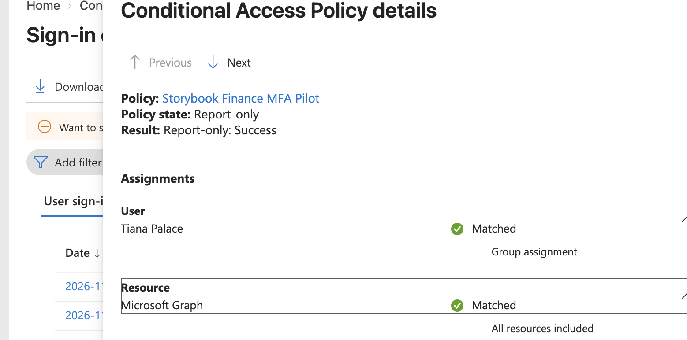
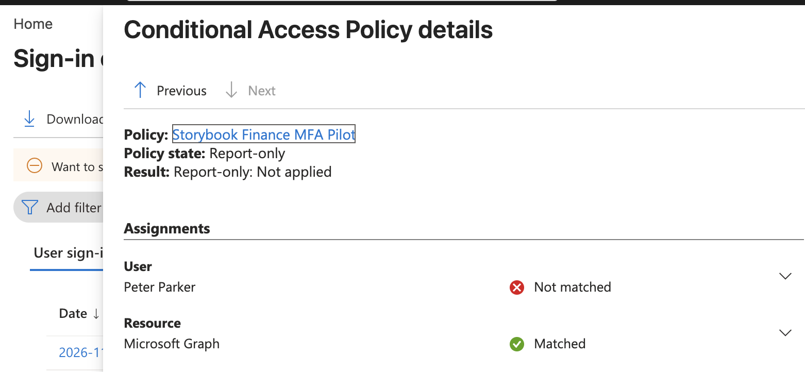
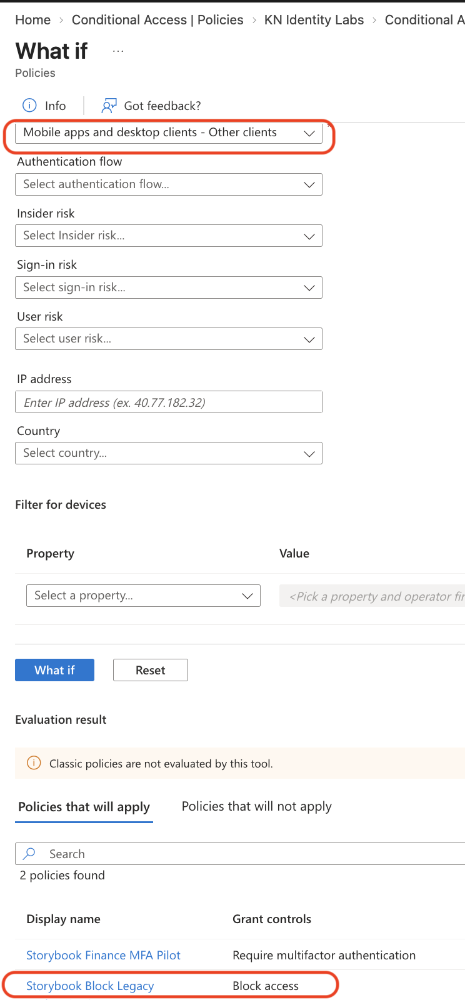
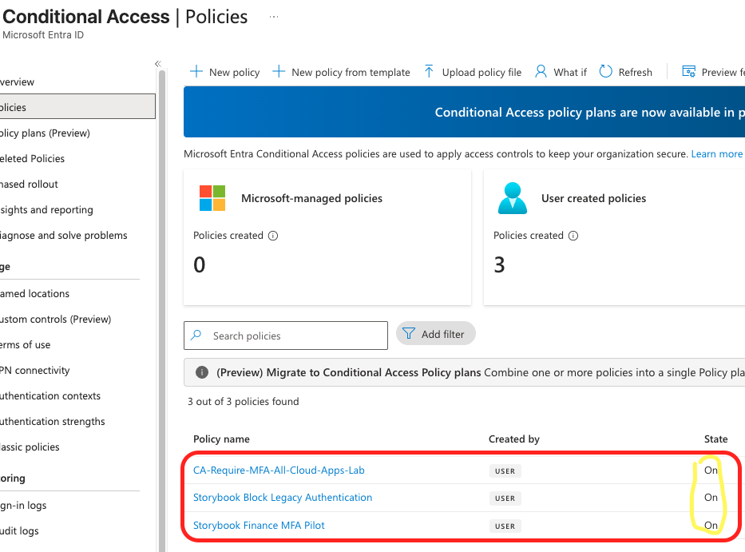
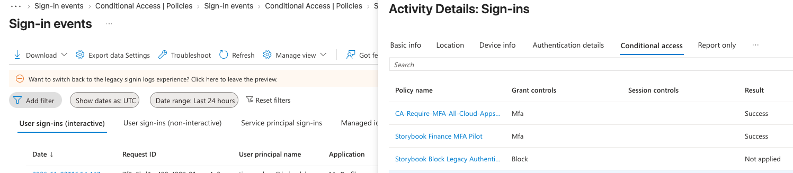

# Storybook Studios Conditional Access Lab

## Overview

Storybook Studios needed stronger protection for employee sign ins. I configured and tested Microsoft Entra Conditional Access policies for MFA and legacy authentication blocking.

## Skills Practiced

## Configuration

I created an assigned pilot group containing Tiana Palace and configured an MFA policy for that group.

I evaluated the policy in Report only before enabling enforcement.

I prepared a broader MFA policy and a policy blocking legacy authentication. I created and tested an emergency administrator account, configured exclusions, and transitioned from Security defaults to the prepared policies.

## Test Results

| Test | Result |
|---|---|
| Tiana evaluated against pilot MFA policy | Report only success |
| Peter evaluated against pilot MFA policy | Not applied |
| Administrator exclusion simulation | Excludes user |
| Legacy authentication simulation using Other clients | Block policy applied |
| Browser authentication simulation | Legacy block policy did not apply |
| Tiana sign in after pilot enforcement | Success |
| Tiana fresh sign in against broad MFA policy | Success |
| Everyday administrator sign in after removing MFA exclusion | Successful access to Policies |

## Troubleshooting

An earlier sign in showed the broad MFA policy as Not applied, with the reason Not included.

I inspected the user assignments and exclusions, confirmed the current scope with What If, and generated a fresh sign in. The new event showed Success.

This reinforced the importance of checking event timestamps and validating current settings with new activity.

## What I Learned

Report only evaluates a policy without enforcing its access requirement.

What If helps test policy scope, while sign in logs provide evidence from actual authentication events.

An MFA requirement can be satisfied without a new prompt. Authentication details help explain the result.

Recovery access and carefully scoped exclusions are part of planning policy changes.

## Evidence

### Pilot evaluation

### Employee outside the pilot

### Legacy authentication simulation

### Enabled policies

### Broad MFA enforcement

## Scope and Limitations

This was a practice tenant using fictional employees.

MFA enforcement was verified with real sign ins. Legacy authentication blocking was evaluated through simulation, without a real legacy authentication attempt.

Location, device compliance, and risk based policies remain separate exercises. This configuration is not a complete production security baseline.
